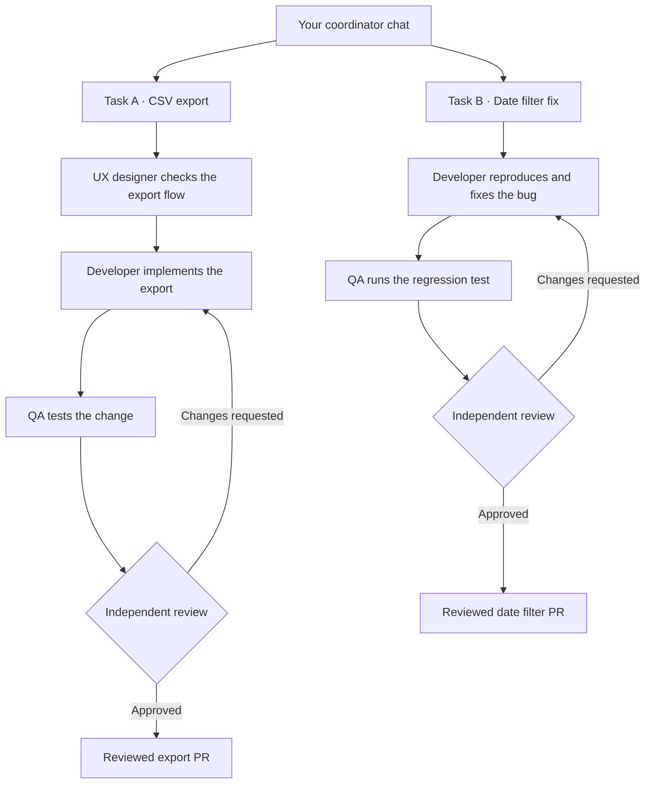

# Build with the Crew

Build with the Crew is a Codex Desktop plugin for taking tasks from a brief to a reviewed pull request. You assign work in one chat. Each task gets its own goal, Git branch and worktree, so you can keep talking to the coordinator while the crew works.

> Add CSV export to the reports page and fix the date filter. Give each change its own task chat and worktree. Run the tests and get both PRs reviewed.



The diagram shows one possible crew. An analyst can clarify which report columns to export, and an architect can help decide how to handle large files. If the export needs a design decision, the date fix can continue. Ask the coordinator for progress on either task. Each task records checkpoints locally, so you can resume it after restarting Codex. For unattended work, keep Codex running and the workstation awake.

By default, the crew leaves reviewed PRs open for you. If you enable automatic merge, the plugin checks that the approval still matches the PR's base and head commits and that every required CI check has passed. A change to either commit requires fresh approval.

## Customize your crew

Ask the coordinator to change your crew in plain language, or edit the `roles` section of `.build-with-the-crew/config.json`. Land changes on the PR's base branch for the reviewer to use them.

> Give the analyst the brainstorming skill as well as user stories. Use Sonnet at medium effort for UX and Opus at high effort for review. Keep Impeccable for UX.

| Role in the config | Job and default skills | What you can change |
| --- | --- | --- |
| `coordinator` | Keeps track of tasks and brings decisions back to you. | Set `effort`, then select that level in the open Codex chat. |
| `task` | Owns one worktree and follows its PR through tests and corrections. | Set `effort` for newly created task chats. |
| `analyst` | Turns the brief into acceptance criteria with `user-stories`. | Choose `skills` and `effort`. |
| `architect` | Evaluates design options and records decisions with `architecture-designer`. | Choose `skills` and `effort`. |
| `developer` | Implements changes with `test-driven-development` and investigates failures with `systematic-debugging`. | Choose `skills` and `effort`. |
| `qa` | Checks edge cases with `test-scenarios` and gathers evidence with `verification-before-completion`. | Choose `skills` and `effort`. |
| `ux` | Assesses the interface from a screenshot using `impeccable`. | Choose `skills`, `effort`, `model` and `runtime`. |
| `review` | Reviews the PR diff with `code-review-excellence` and returns approval or requests changes. | Choose `skills`, `effort`, `model` and `runtime`. |

<details>
<summary>See an example configuration for all eight roles</summary>

Merge this `roles` object into your existing project configuration. A `skills` list replaces the defaults for that role. Omit a field to keep its default. Choose skill names from the [bundled catalog](plugins/build-with-the-crew/role-skills/).

```json
{
  "roles": {
    "coordinator": { "effort": "medium" },
    "task": { "effort": "medium" },
    "analyst": { "skills": ["user-stories", "brainstorming"], "effort": "medium" },
    "architect": { "skills": ["architecture-designer"], "effort": "high" },
    "developer": { "skills": ["test-driven-development", "systematic-debugging"], "effort": "high" },
    "qa": { "skills": ["test-scenarios", "verification-before-completion"], "effort": "medium" },
    "ux": { "runtime": "claude-code", "model": "sonnet", "effort": "medium", "skills": ["impeccable"] },
    "review": { "runtime": "claude-code", "model": "opus", "effort": "high", "skills": ["code-review-excellence"] }
  }
}
```

</details>

UX and review default to Opus through the bundled Claude Code adapter. To use another provider for either role, register a local adapter for its CLI. Native specialists can use their own effort when delegated. If a role runs in the task chat, its explicit effort must match that chat's setting. If the host cannot apply the level, the task pauses that role. [Effort levels and provider adapters](docs/configuration.md#reasoning-effort)

## Install

You need Codex Desktop and its CLI, Git, Node.js 22 or later, and an authenticated GitHub CLI (`gh`) for github.com. For the built-in UX and review specialists, install the Claude Code CLI and sign in with a Claude subscription. On Windows, put the native `claude.exe` on your PATH.

Run these commands once per Codex profile:

```sh
codex plugin marketplace add abertoletti/build-with-the-crew
codex plugin add build-with-the-crew@crew-tools
```

Codex installs both workflow skills, the role skills and the supporting scripts together.

If you installed the local preview, remove it with `codex plugin remove metodo@metodo-locale` after installing the new plugin, then open a fresh chat. Existing task journals remain usable. For project settings, follow the [configuration upgrade instructions](docs/configuration.md).

### Authenticate Claude

For interactive work, run `claude auth login`. For unattended work, run `claude setup-token` in your own terminal and supply the resulting secret as `CLAUDE_CODE_OAUTH_TOKEN` to the process launching Codex. Restart Codex if its environment changed. Keep the token in your secret manager. [Claude Code authentication](https://code.claude.com/docs/en/authentication#generate-a-long-lived-token)

### Configure your project

Open a fresh Codex Desktop chat in your Git repository and ask:

> Configure Build with the Crew for pull requests to main. Use this project's test commands and CI checks.

The coordinator creates `.build-with-the-crew/config.json` in your project. Commit it to the remote base branch before assigning the first task. If you already configured this project with 0.2.0, move the existing settings file to this path. For automatic merge, set `integration` to `merge` and name at least one required CI check. [Configuration and recovery](docs/configuration.md)

## Test

Run these commands from a clone of this repository.

| Command | What it exercises |
| --- | --- |
| `npm test` | Offline tests for task state, review and merge gates, and bundled skill integrity |
| `npm run test:install` | Install, discovery and upgrade in a temporary Codex profile. Requires PowerShell 7.2+ |
| `npm run test:review:live` | Two real Claude reviews of synthetic code, before and after a correction |
| `npm run test:token:live` | One real review using the secret supplied via `CLAUDE_CODE_OAUTH_TOKEN` |
| `npm run test:ux:live` | A real UX review of the bundled pickup screen using Impeccable. Requires PowerShell 7.2+ |

Live tests use your Claude subscription quota.

## License

Original code is MIT. Bundled skills retain their upstream licenses. [License](LICENSE) | [Third-party notices](plugins/build-with-the-crew/role-skills/_licenses/)
